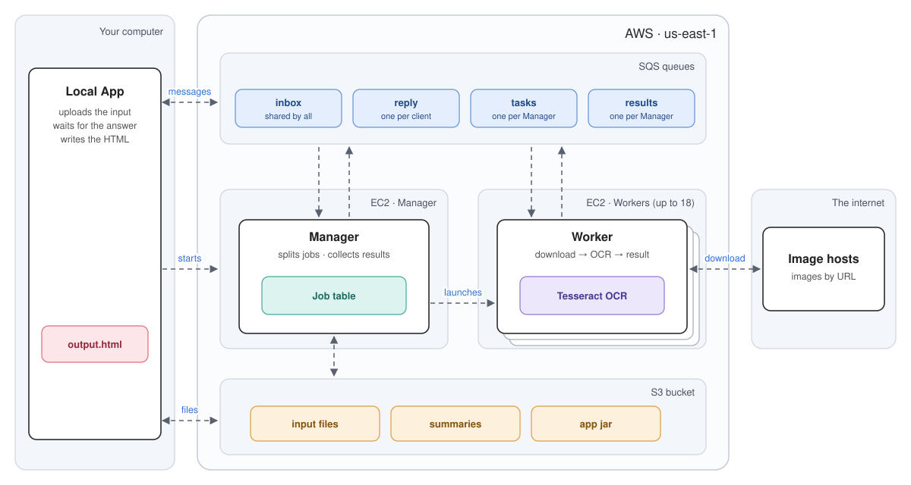

# OCR in the Cloud 


A distributed system that reads a list of image URLs, runs OCR (text recognition) on every image in parallel on
AWS, and writes an HTML page with each image and its text.

## How to run

You need Java 17, Maven, and AWS credentials in `~/.aws/credentials` (from the AWS Academy lab).

1. Build: `mvn package` (creates `target/aws-distributed-ocr.jar`).
2. Upload the jar for the cloud instances (they download it when they start):
   `aws s3 cp target/aws-distributed-ocr.jar s3://dsp-ocr-a1/app/aws-distributed-ocr.jar`
3. Run:
   ```
   java -jar target/aws-distributed-ocr.jar inputFileName outputFileName manager-clients-n worker-files-n [terminate]
   ```

The bucket name, the AMI and the other settings are in `Config.java`. The AMI was built once from
`scripts/ami-setup.sh`.

## Architecture



The parts never call each other directly. They only talk through **SQS queues** (messages) and **S3** (files).

### How a job flows

1. The **Local App** uploads the input file to S3. It checks (with EC2 tags) whether a Manager with free room exists,
   and starts one if not.
2. It creates its own reply queue and sends a "new job" message to the shared inbox queue.
3. A **Manager** with free room takes the job, downloads the input file, and sends one task per URL to its task queue.
4. The Manager starts **Workers**: one per `worker-files-n` URLs, minus the Workers it already has, and never more
   than 19 instances in total.
5. Each Worker takes one task at a time: it downloads the image, runs OCR (Tesseract), sends the text (or a short
   error) to the results queue, and only then deletes the task.
6. When all the results of a job are in, the Manager writes a summary file to S3 and sends "done" to the client's
   reply queue.
7. The Local App downloads the summary and writes the HTML. With `terminate`, it then sends a terminate message.

### Queues

| Queue | From → To | Message |
|---|---|---|
| inbox (one, shared) | Local Apps → Managers | new job (where the input is, where to reply) or terminate |
| tasks (one per Manager) | Manager → its Workers | one image URL and its line number |
| results (one per Manager) | Workers → Manager | the text, or an error, for one image |
| reply (one per client) | Manager → Local App | "done, the summary is here", or "rejected" |

## Run details

- **AMI:** `ami-0725885594e989fad`, Ubuntu 24.04 with Java 17, Tesseract 5.3.4 (English) and the AWS CLI. Our jar
  is not inside the AMI: every instance downloads the current jar from S3 when it starts.
- **Instance type:** `t3.micro` for the Manager and the Workers.
- **Time and n** (final run: the assignment's sample input, 24 URLs, with **two clients at the same time**,
  `manager-clients-n` = 2, **`worker-files-n` = 5**):
  - One Manager served both clients and started **5 Workers** (24 / 5 rounded up; the second job needed no more).
  - Client 1: **97 seconds** from start to HTML (this includes starting the Manager and the Workers).
    Client 2, started 15 seconds later with `terminate`: **74 seconds**.
  - After `terminate`, every instance was shut down and every queue but the shared inbox deleted, within about
    two minutes.
  - The outputs are in `sample/`. 12 of the 24 sample URLs no longer exist on the internet (HTTP 404 or unknown
    host); they appear as error lines.

## Design questions

**Security.** No credentials exist in the code, the jar or the instance startup scripts. Instances get their AWS
permissions from an IAM role (`LabInstanceProfile`), and the local credentials file stays outside the project
(it is in `.gitignore`). The bucket is private. OCR text is escaped in the HTML, so it can't inject markup.

**Scalability.** Clients never talk to a specific Manager: they put jobs in the shared inbox, and any Manager with
free room takes them. When every Manager is full (`manager-clients-n` clients), the next client starts another
Manager. Each Manager runs its own Workers, shared by its clients. The hard limit is 19 instances (AWS Academy):
with a million clients, jobs wait safely in SQS and finish later; nothing is lost. SQS and S3 grow by themselves.

**Persistence: what if a node dies or stalls?**
- *A Worker dies or stalls:* it doesn't delete its task, so the task becomes visible again after 120 seconds and
  another Worker does it. Downloads have time limits. An image that fails 3 times is reported as an error line
  instead of being tried forever.
- *A Manager dies:* the job's message stays (hidden) in the inbox until the job is done. The Manager keeps it
  hidden with a heartbeat every minute. If the Manager dies, the heartbeat stops, the message comes back within
  3 minutes, and another Manager redoes the job. If any Manager thread crashes, the whole Manager exits so this
  can happen. Every minute, a waiting Local App makes sure a Manager exists, and removes Workers and queues that a
  dead Manager left behind.
- *Duplicate messages* (SQS may deliver a message twice): each result carries its line number, and the Manager
  ignores repeats.
- *Broken communication:* temporary errors are retried. A job that can't start is retried up to 3 times; after
  that the client gets "rejected" instead of waiting forever.

**Threads.** The Manager uses threads because it serves many clients at once: one thread reads the inbox, one reads
results, one pool starts jobs, one pool finishes jobs, and one timer runs the heartbeat and checks. Slow work (S3,
sending many messages) never blocks reading the queues, and different clients' jobs run in parallel. Only one
thread reads each queue, because more pollers would only mean more paid requests and more locking. A Worker uses a
single thread: it handles one image at a time, and we scale by adding Workers. The Local App has one thread; it
only waits.

**More than one client.** Yes: the final run had two clients at the same time on EC2 (see Run details), and both
got complete, correct results. Each client has its own reply queue, so answers never mix, and the Manager tracks
each job separately.

**Termination.** The Manager that gets the terminate message marks every Manager (with an EC2 tag). Each Manager
then stops taking jobs, answers "rejected" to jobs that were waiting, finishes the jobs in progress, terminates its
Workers, deletes its queues, and terminates itself. Managers with no work also shut down by themselves: Workers
after 5 idle minutes, the Manager after 10.

**System limitations.** At most 19 instances; AWS Academy credentials expire with each lab session; `t3.micro` has
1 GB of memory; OCR quality is weak on tiny or stylized images. Jobs share one task queue per Manager, so a big job
sent first can delay a small job behind it.

**Are all Workers working hard?** Yes. A Worker takes one task at a time, so a free Worker always gets the next
image and no Worker holds work that others could do. The Manager starts only the Workers a job needs, and stops
idle ones.

**Is the Manager doing more than it should?** No. It only coordinates: it reads jobs, sends tasks, counts results,
and writes summaries. It never downloads images or runs OCR, and Workers never make decisions.

**Is it really distributed?** Yes. No part waits on another part directly; they only exchange messages and files.
Any part can stop, restart or be replaced without the others noticing.


